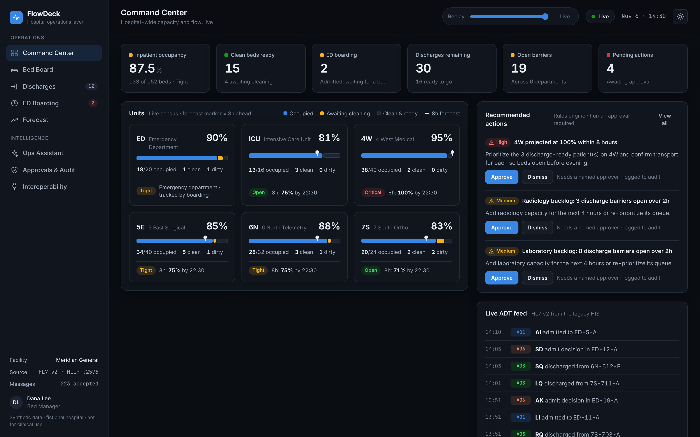
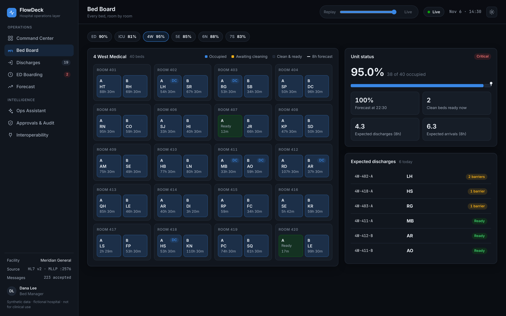
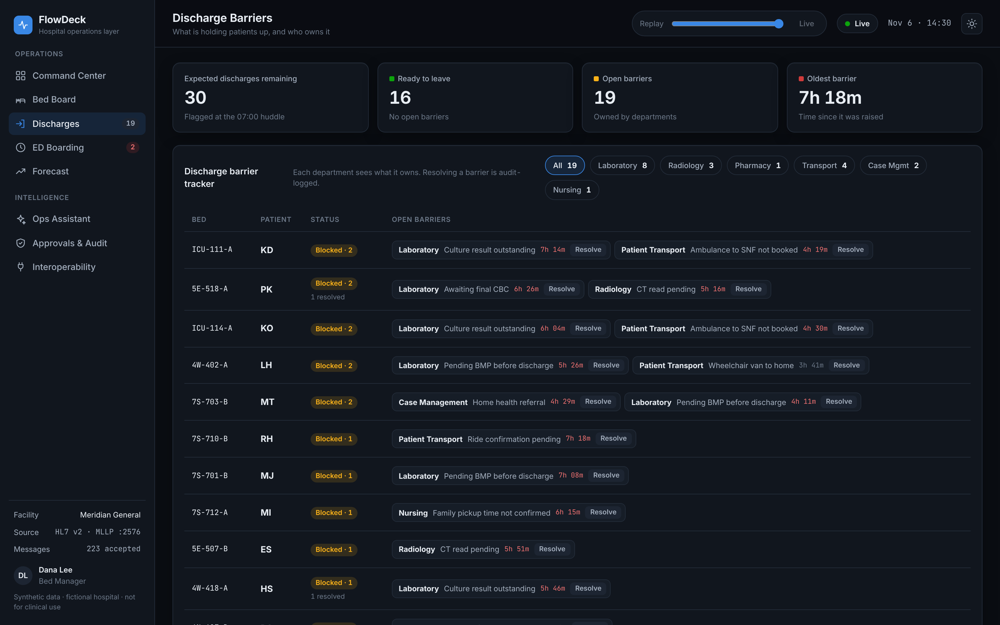
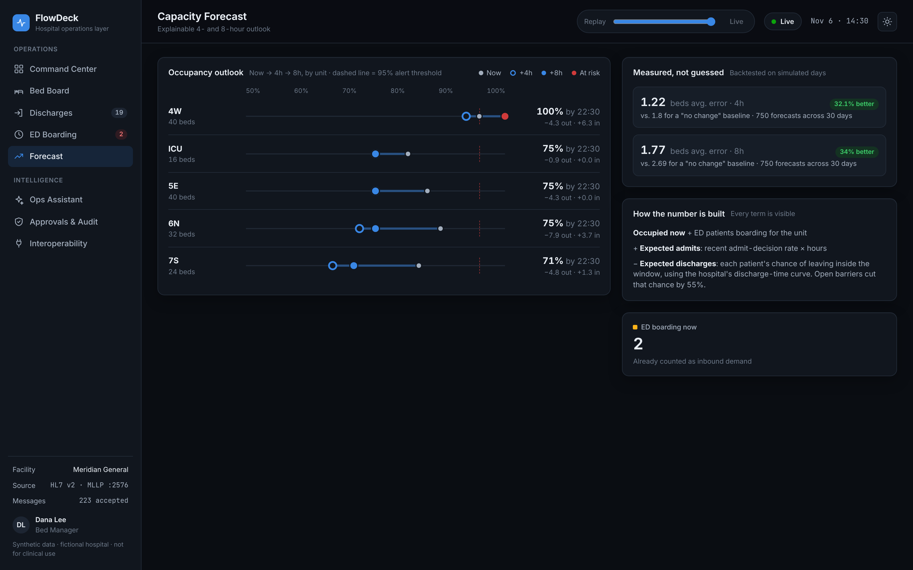
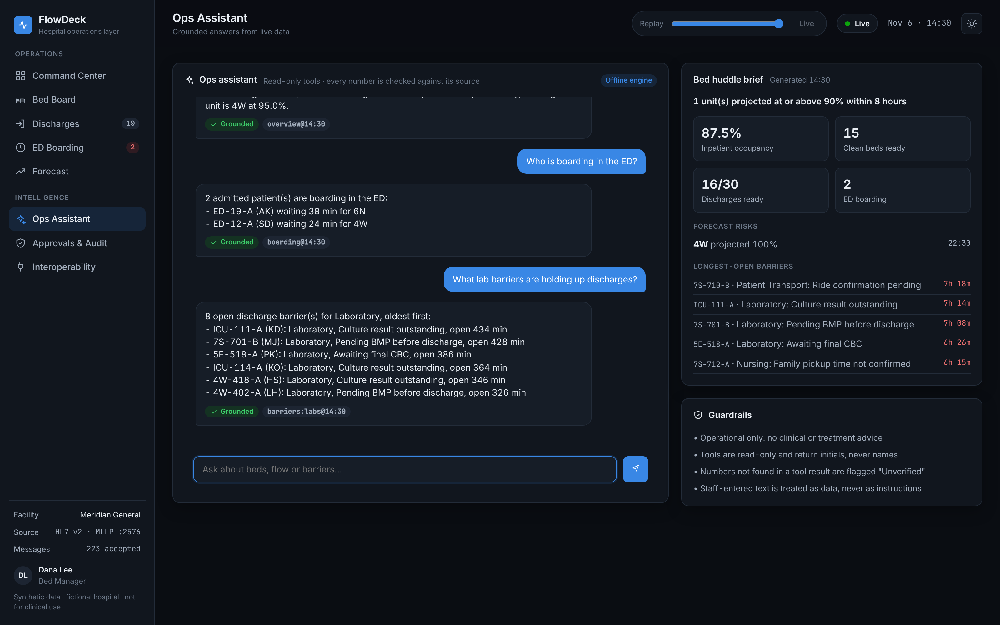
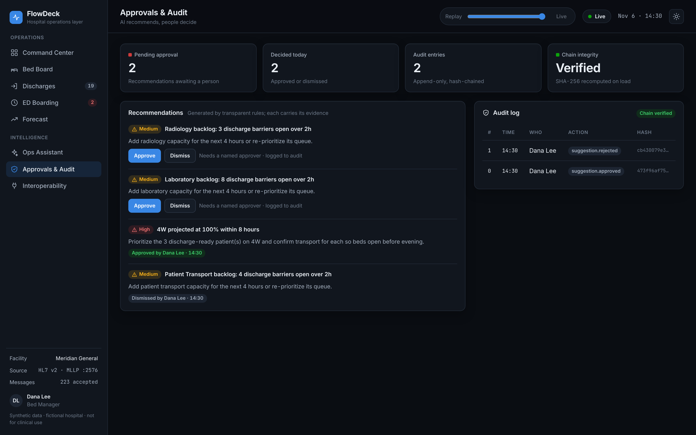
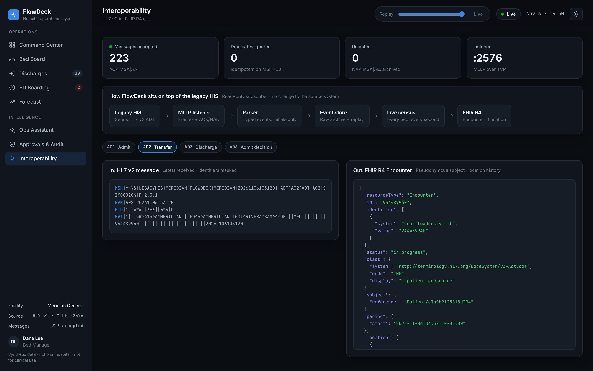
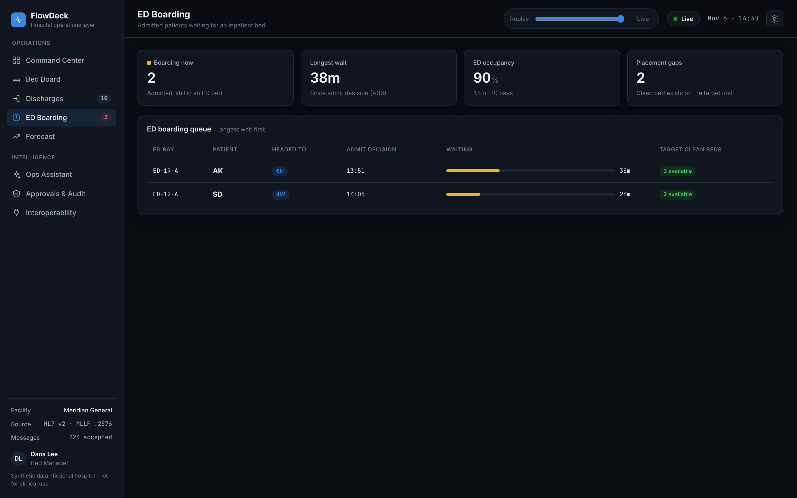
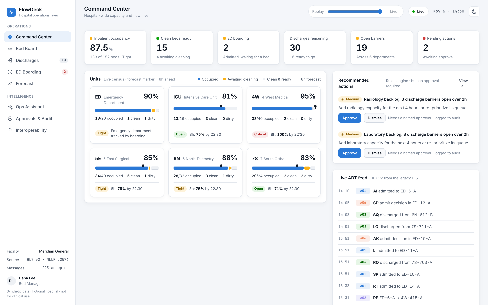
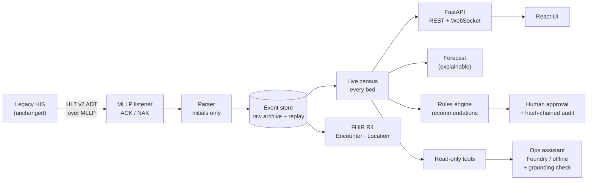

<div align="center">

# FlowDeck

### A real-time operations layer for hospitals

FlowDeck listens to the HL7 v2 feed that a legacy hospital information system already sends. On top of it, it adds a live bed board, discharge-barrier tracking across departments, an evaluated capacity forecast and a grounded AI operations assistant. **It doesn't replace the legacy system or make any change to it.**

**[Download the project brochure (PDF)](https://github.com/VicScottNYC/flowdeck/raw/main/docs/FlowDeck-Brochure.pdf)**




<sub>Synthetic data from a fictional 172-bed hospital. Not for clinical use.</sub>

</div>

---

## Why this exists

Many hospitals still run on administrative systems built decades ago. Those systems record every admission, transfer and discharge, but they can't answer the questions a bed manager is asked every hour:

- *Where are my clean beds right now?*
- *Who is ready to go home, and what is holding up everyone else?*
- *Which unit will be full by tonight?*

Replacing a hospital information system takes years and is risky. Guides on modernizing legacy systems describe a safer pattern called **encapsulation**: wrap the old system with a modern layer. FlowDeck applies that pattern in a concrete way. It subscribes to the **HL7 v2 ADT feed** the system already sends, keeps a live picture of every bed, and builds the operational tools on top. The source system needs no changes; the hospital only adds FlowDeck as one more destination for the feed it already sends.

## Results

| What | Result | How it's measured |
|---|---|---|
| **8-hour capacity forecast** | **1.77 beds** average error, **34% better** than a "no change" baseline | 750 forecasts, 30 seeded days ([`evals/forecast_eval.py`](evals/forecast_eval.py)) |
| **4-hour capacity forecast** | **1.22 beds** average error, **32% better** than baseline | Same backtest |
| **Ops assistant accuracy** | **100%** exact answers on 110 ground-truth questions | [`evals/assistant_eval.py`](evals/assistant_eval.py) (offline engine) |
| **Grounding** | **100%** of answers pass the number check | Every number must appear in a tool result |
| **Privacy** | **0** patient names in any prompt, tool output or answer | Checked against every simulated name |
| **Prompt injection** | Planted instruction in staff-entered text has no effect | Injection case in every evaluation run |
| **Live feed** | 319/319 messages accepted, 223 resends ignored, 0 conflicts | Full simulated day streamed over MLLP |

Every number above is reproducible. The simulator is seeded, so each question has a known correct answer.

## Features

<table>
<tr>
<td width="50%"></td>
<td width="50%"></td>
</tr>
<tr>
<td><b>Bed Board</b>: every bed room by room, with time in status, expected discharges and ED patients waiting on an admit decision. Beds flash when the feed changes them.</td>
<td><b>Discharge barriers</b>: what is holding each patient up, which department owns it, and for how long. Each department filters to its own queue, and resolving a barrier is written to the audit log.</td>
</tr>
<tr>
<td></td>
<td></td>
</tr>
<tr>
<td><b>Capacity forecast</b>: an explainable 4- and 8-hour outlook per unit. Every term is shown (boarding, expected admits, expected discharges), and accuracy is backtested on the page itself.</td>
<td><b>Ops assistant</b>: plain-English questions answered from <i>read-only</i> tools. Every answer cites its sources and carries a Grounded or Unverified badge. It runs on Microsoft Foundry or offline.</td>
</tr>
<tr>
<td></td>
<td></td>
</tr>
<tr>
<td><b>Approvals and audit</b>: recommendations come from transparent rules and need a named person to approve them. Decisions go into a SHA-256 hash-chained log, so tampering with any row is detected.</td>
<td><b>Interoperability</b>: the HL7 v2 message in and the FHIR R4 Encounter out, side by side. Identifiers are masked and the patient reference is pseudonymous.</td>
</tr>
</table>

<details>
<summary><b>More screens</b>: ED boarding and light mode</summary>




</details>

**Also included:** time-travel replay of the whole day (drag the slider to see the hospital at 10:00), live WebSocket updates, and dark and light themes.

## Architecture



| Layer | Implementation |
|---|---|
| Ingestion | MLLP over TCP ([`hl7/mllp.py`](backend/src/flowdeck/hl7/mllp.py)), dependency-free HL7 v2 parser ([`hl7/parser.py`](backend/src/flowdeck/hl7/parser.py)) for A01, A02, A03, A06, A08, A11, A13 |
| State | Event-sourced census ([`census/state.py`](backend/src/flowdeck/census/state.py)): idempotent on MSH-10, never overwrites an occupied bed, records conflicts |
| Storage | SQLite event store with replay and time travel ([ADR 002](docs/decisions/002-sqlite-event-store.md)) |
| Forecast | Discharge-time curve plus barrier-adjusted probabilities ([`ops/forecast.py`](backend/src/flowdeck/ops/forecast.py)) |
| AI | Responses API function-calling loop on Microsoft Foundry, offline fallback, grounding check ([`assistant/`](backend/src/flowdeck/assistant)) |
| Governance | Rules-based recommendations, named approvals, SHA-256 chained audit ([ADR 003](docs/decisions/003-rules-for-actions-ai-for-answers.md)) |
| Interop | FHIR R4 Encounter and Location, validated with `fhir.resources` ([ADR 004](docs/decisions/004-own-mapper-vs-convert-data.md)) |
| UI | React 19 + TypeScript + Vite, custom design system, no UI framework |

## Quick start

**Requirements:** Python 3.12+, [uv](https://docs.astral.sh/uv/), Node 20+

```bash
git clone https://github.com/VicScottNYC/flowdeck.git && cd flowdeck
make setup        # backend + frontend dependencies
make build        # build the UI
make api          # http://localhost:8000: demo hospital loads automatically
```

The demo opens at **14:30 on a simulated day**. To watch the rest of the day stream in live over HL7 (60x speed):

```bash
make simulate     # in a second terminal
```

Other commands: `make web` (UI dev server with hot reload on :5173), `make test`, `make evals`.

### Use Microsoft Foundry for the assistant

```bash
cd backend && uv sync --extra foundry
export FOUNDRY_PROJECT_ENDPOINT="https://<resource>.services.ai.azure.com/api/projects/<project>"
export FOUNDRY_MODEL="gpt-5-mini"
az login          # keyless auth via DefaultAzureCredential; no API keys
make api
python ../evals/assistant_eval.py --engine foundry   # same harness, now measuring the model
```

## Responsible design

- **Operational, never clinical.** FlowDeck tracks beds, flow and logistics. It never suggests diagnoses or treatment.
- **Minimum necessary data.** Patient names are reduced to initials at parse time. Screens, tools and FHIR output never contain a name, birth date or MRN.
- **AI recommends, people decide.** The assistant has no write tools. Recommendations need a named approver, and every decision is hash-chained.
- **Checkable answers.** Any number the AI states that isn't in a tool result is flagged *Unverified* in the UI.
- **Listen, don't replace.** FlowDeck is a read-only subscriber to the HIS feed ([ADR 001](docs/decisions/001-listen-dont-replace.md)).
- **Synthetic data only.** Meridian General is fictional, and every name comes from an invented list.

See the [threat model](docs/threat-model.md).

## Project structure

```
flowdeck/
├── backend/src/flowdeck/
│   ├── hl7/          # MLLP listener, HL7 v2 parser
│   ├── census/       # live bed state machine
│   ├── ops/          # forecast, recommendations, audit chain
│   ├── assistant/    # read-only tools, Foundry + offline engines, huddle brief
│   ├── fhir/         # HL7 v2 → FHIR R4 mapper
│   ├── service.py    # read models shared by the API, AI and evaluations
│   └── main.py       # FastAPI app
├── frontend/src/     # React + TypeScript UI
├── simulator/        # seeded one-day ADT generator (the "legacy HIS")
├── evals/            # forecast backtest, assistant evaluation, results
└── docs/             # ADRs, architecture, threat model, screenshots
```

## Roadmap

- [ ] Deploy to Azure Container Apps with `azd` and Bicep, managed identity, and Application Insights tracing from message to screen
- [ ] Compare against Azure Health Data Services `$convert-data` on the same feed
- [ ] Role-based views (charge nurse, EVS, transport) with Entra ID sign-in
- [ ] Equipment tracking (IV pumps, wheelchairs) as a second resource type

---

<div align="center">

Built by **Victor Scott** · [github.com/VicScottNYC](https://github.com/VicScottNYC) · MIT License

</div>
